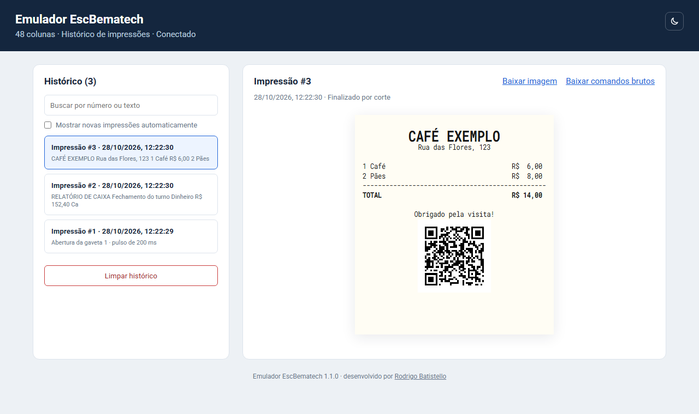

# Emulador EscBematech

Impressora térmica virtual para testar sistemas que imprimem no padrão **EscBematech**. O emulador recebe as impressões pela rede (TCP/RAW, porta 9100) e mostra cada uma num histórico no navegador, desenhada num papel de 48 colunas.

Funciona com qualquer sistema que imprima nesse padrão; no ACBr, corresponde ao modelo `ppEscBematech`.

<picture>
  <source media="(prefers-color-scheme: dark)" srcset="docs/screenshot-dark.png">
  
</picture>

## Recursos

- **Prévia do papel:** cada impressão é desenhada em 48 colunas na fonte normal e 64 na condensada, com negrito, itálico, sublinhado, largura e altura dupla, alinhamento e QR code nativo. Serve para conferir o layout durante o desenvolvimento, mas é uma aproximação: fontes e espaçamentos podem diferir em detalhes, e imagens, logotipos e códigos de barras aparecem só como aviso.
- **Histórico persistente:** as impressões ficam salvas entre reinicializações, com busca, download como imagem PNG ou com os bytes originais.
- **Avisos de nova impressão:** com a aba em segundo plano, o título conta as impressões novas e o ícone ganha um ponto; a página pode mostrar cada impressão nova assim que chega.
- **Gaveta registrada:** aberturas de gaveta aparecem no histórico com o número da gaveta e a duração do pulso.
- **Sem instalação:** um executável único para Windows, na bandeja perto do relógio, e outro para Linux. Pelos fontes, só a biblioteca padrão do Python.

## Download

Baixe o pacote do seu sistema na [página de Releases](https://github.com/robatistello/emulador-esc-bematech/releases/latest). Cada pacote traz um `LEIA-ME.txt` com o passo a passo para quem vai usar.

| Sistema | Pacote | Requisitos |
|---|---|---|
| Windows | `EmuladorEscBematech-X.Y.Z-windows.zip` | Windows 10 ou 11 de 64 bits |
| Linux | `EmuladorEscBematech-X.Y.Z-linux.tar.gz` | x86_64 com glibc 2.17 ou mais nova (CentOS 7, Debian 11, Ubuntu 20.04 e posteriores) |

**Windows:** extraia o zip numa pasta com permissão de escrita e abra o `EmuladorEscBematech.exe`. Ele fica na bandeja do Windows; o duplo clique no ícone abre o histórico, e o botão direito oferece **Abrir histórico** e **Sair**.

**Linux:** não há bandeja; o programa roda no terminal e encerra com Ctrl+C.

```bash
tar -xzf EmuladorEscBematech-*-linux.tar.gz
cd EmuladorEscBematech-*-linux
chmod +x EmuladorEscBematech
./EmuladorEscBematech
```

O `chmod` repõe a permissão de execução quando o pacote foi extraído por uma ferramenta do Windows. O binário Linux não funciona no Alpine, que usa musl em vez de glibc, nem em ARM; nesses casos, [rode pelos fontes](#executar-pelos-fontes).

Nos dois sistemas, o histórico fica em `data/history.sqlite3`, ao lado do executável, e abre em http://127.0.0.1:9101.

## Configurar o sistema que imprime

| Configuração | Valor |
|---|---|
| Modelo | Bematech / EscBematech (no ACBr, `ACBrPosPrinter` com modelo `ppEscBematech`) |
| Conexão | TCP/RAW em `127.0.0.1:9100` (no ACBr, porta `TCP:127.0.0.1:9100`) |
| Colunas da fonte normal | `48` (no ACBr, `ColunasFonteNormal`) |
| Página de código | CP850 (padrão), CP437, CP860 ou UTF-8 |

Desabilite a leitura de status da impressora: o emulador consome essas consultas sem responder.

## Uso do histórico

- **Seleção:** a chegada de uma impressão não troca a impressão que está aberta, a menos que **Mostrar novas impressões automaticamente** esteja marcado. Nesse caso, a mais recente abre sozinha, exceto as que são só abertura de gaveta, para que a gaveta enviada logo depois do cupom não esconda a impressão.
- **Aba em segundo plano:** o título mostra quantas impressões chegaram, como "(2) Emulador EscBematech", e o ícone ganha um ponto vermelho. Em abas esquecidas por vários minutos, o navegador espaça as consultas e o aviso pode levar até um minuto.
- **Busca:** procura no número e nos primeiros 90 caracteres do texto; `#10` encontra só a impressão 10.
- **Downloads:** cada impressão pode ser baixada como PNG, na resolução da impressora, ou com os bytes originais (`.bin`). O nome do arquivo leva o número, a data e a hora, como `impressao-12_2026-10-13_19-35-19.png`.
- **Limpar histórico:** apaga todas as impressões, após confirmação. Para backup, feche o emulador e copie o `data/history.sqlite3`.
- **Tema:** segue o claro ou escuro do sistema; o botão de sol e lua no cabeçalho alterna entre eles.

Uma impressão termina num corte (`ESC w` ou `ESC m`), ao encerrar a conexão ou após 60 segundos sem dados; os detalhes mostram o motivo. Uma conexão pode trazer várias impressões. Envios sem texto, QR, gaveta nem aviso, como uma inicialização logo depois do corte, não viram impressão. O limite é de 10 MiB por conexão.

## Opções

As mesmas opções valem para o executável e para os fontes:

| Opção | Efeito |
|---|---|
| `--port 9102` | Porta da impressora (padrão 9100) |
| `--web-port 9103` | Porta do histórico (padrão 9101) |
| `--host 0.0.0.0` | Aceita impressões de outros computadores da rede |
| `--db caminho.sqlite3` | Arquivo do histórico |
| `--console` | No Windows, roda no terminal em vez da bandeja |
| `--version`, `--licenses`, `--help` | Versão, licenças de terceiros e ajuda |

Abrir o programa de novo enquanto ele já está aberto só abre o histórico da instância em execução. Se a porta estiver ocupada por outro programa, a mensagem diz qual e sugere `--port` ou `--web-port`.

Com `--host 0.0.0.0`, configure o sistema com o IP do computador do emulador e abra o histórico pelo IP, como `http://192.168.0.10:9101`, ou por `localhost`. Nomes de máquina são recusados para impedir DNS rebinding. **O histórico não tem senha:** use só em rede confiável, e talvez seja preciso liberar as portas no firewall.

## Comandos suportados e limites

Interpreta inicialização e seleção EscBema, texto, quebras, alinhamento, negrito (`ESC E/F`), itálico (`ESC 4/5`), sublinhado, fonte condensada (`ESC SI/H`), largura dupla (`ESC W`), altura dupla (`ESC d`), modo de impressão (`ESC !`), espaçamento, página de código, cortes e gaveta.

O QR nativo `GS k Q` é desenhado no navegador, com níveis L/M/Q/H, o tamanho de módulo recebido e margem de quatro módulos, sem precisar de internet. Os bytes do conteúdo são preservados, e o QR é reduzido se passar de 40% da largura do papel. Se o conteúdo exceder a capacidade do nível de correção, o QR é omitido com um aviso.

Não são desenhados, e geram aviso: imagens `ESC *`, logos `FS p` e códigos de barras. Não há modo página, USB, porta serial nem spooler do Windows. As fontes e dimensões são aproximadas. Comandos desconhecidos podem afetar os bytes seguintes. A referência dos comandos é o [ACBrEscBematech.pas](https://sourceforge.net/p/acbr/code/HEAD/tree/trunk2/Fontes/ACBrSerial/ACBrEscBematech.pas), do Projeto ACBr.

## Executar pelos fontes

Com Python 3.14 ou superior, sem dependências a instalar, na pasta do projeto:

```bash
python -m emulator
```

Se o sistema tiver um Python mais antigo, como no Raspberry Pi OS, Debian ou Ubuntu, o [uv](https://docs.astral.sh/uv/) baixa o 3.14 só para o emulador, sem mexer no Python do sistema:

```bash
uv run --no-project --python 3.14 python -m emulator
```

No Windows, prefira o lançador `py`, que não depende do atalho da Microsoft Store: `py -m emulator` no terminal, `py -m emulator --tray` para a bandeja mantendo o terminal, ou `pyw -m emulator --tray` para a bandeja sem terminal. Para enviar uma impressão de exemplo, em outro terminal:

```bash
python tools/send_demo.py --qr
```

## Contribuir

Testes, padrão de escrita do código, formatação, build dos executáveis e publicação de versões estão em [CONTRIBUTING.md](CONTRIBUTING.md).

## Licença

Este é um projeto independente, sem vínculo, patrocínio ou endosso dos titulares da marca Bematech. Bematech é marca de seus respectivos titulares; o nome aparece aqui só para indicar compatibilidade com o padrão de comandos EscBematech.

Desenvolvido por [Rodrigo Batistello](https://github.com/robatistello) e distribuído sob a licença MIT; veja [LICENSE](LICENSE). A geração de QR usa o qrcode-generator (MIT), e a página usa as fontes Roboto e Roboto Mono (OFL); veja [THIRD-PARTY-NOTICES.txt](THIRD-PARTY-NOTICES.txt). Os executáveis também levam o Python e as bibliotecas que ele usa; as licenças desses componentes acompanham cada pacote, no `THIRD-PARTY-NOTICES.txt` ao lado do programa, e aparecem com `--licenses`.
